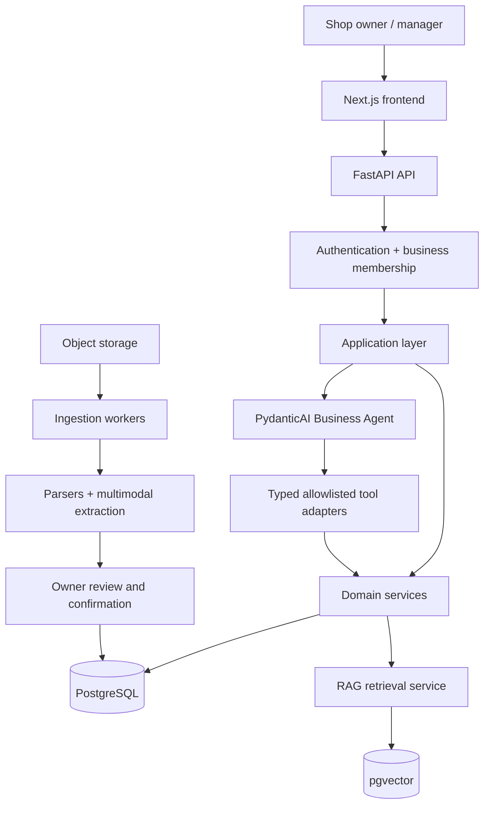

# DukaanAI — Technical Architecture

**Version:** 2.0  
**Status:** Approved target architecture  
**Design:** Modular monolith + PydanticAI orchestrator + deterministic domain services + PostgreSQL/pgvector

## 1. Architecture goals

- Maintainable platform for Indian small retailers, initially kirana stores.
- Deterministic, auditable and tenant-isolated business facts and ledgers.
- LLM interprets and orchestrates; it does not calculate authoritative numbers.
- RAG is selective document retrieval, not the architecture.
- Udhar is a first-class domain with a proper ledger.
- System is testable without an LLM.
- Financially consequential actions require explicit user confirmation.

## 2. High-level architecture

### AI Chat permission boundary
AI Chat uses authenticated user-scoped `chat_conversations` and `chat_messages`; `business_id` is nullable and is only written after a server-side membership lookup. General mode constructs a PydanticAI agent with no registered tools and never calls retrieval. Business Context explicitly resolves an active membership and reuses `create_decision_agent`, which exposes only the existing typed tools and tenant-filtered RAG. Each message records its mode, and generation history is restricted to that mode so a mode switch cannot carry prior business data into General mode. Conversation owner checks precede reads and mutations. Context is bounded to 20 recent messages.



### Request flow
1. Frontend sends authenticated request.
2. FastAPI authenticates and resolves authorized business membership.
3. Backend creates trusted `BusinessContext` (`business_id`, `user_id`, role/permissions, locale).
4. Copilot request constructs PydanticAI dependencies from trusted context and service interfaces.
5. Agent selects typed, allowlisted tools.
6. Tool adapters call deterministic domain services.
7. Services query tenant-scoped repositories and return typed results plus evidence.
8. Agent explains results without changing authoritative values.
9. Proposed write actions are shown for confirmation and executed through a separate authenticated endpoint.

**PydanticAI does not replace FastAPI, PostgreSQL, RAG or domain services.**

## 3. Technology direction

| Layer | Technology |
|---|---|
| Frontend | Next.js + React + TypeScript |
| UI | Tailwind CSS + shadcn/ui |
| Charts | Recharts |
| API state/forms | TanStack Query; React Hook Form + Zod |
| Backend | Python + FastAPI |
| Validation | Pydantic |
| Agent | PydanticAI |
| LLM | Gemini via provider/config abstraction supported by pinned PydanticAI version |
| Database | Neon PostgreSQL |
| Vector retrieval | pgvector |
| Original files | Supabase Storage or equivalent object storage |
| Embeddings | Provider abstraction; validate multilingual retrieval and dimensions |
| Analytics | SQL + Pandas + NumPy |
| Forecasting | Transparent baselines first; Statsmodels when justified |
| Optimization | SciPy or transparent discrete optimizer |
| PDF extraction | PyMuPDF |
| OCR fallback | Tesseract or multimodal provider |
| Hosting | Vercel frontend; Render/Railway backend |

### Explicit decisions
- One PydanticAI orchestrator initially; add specialist agents only for measured, bounded need.
- PostgreSQL is source of truth for structured business data.
- pgvector is the initial vector store.
- Do not add ArangoDB: no graph traversal requirement.
- Do not add ChromaDB by default: pgvector is sufficient initially.
- Do not add LangChain by default: PydanticAI plus direct provider SDKs and a small retrieval pipeline are easier to inspect.
- SQLite may be used for isolated tests, not as the intended production source of truth.
- Pin and test exact PydanticAI/provider versions; APIs evolve.

## 4. Suggested repository layout

Adapt to existing code; do not move files unnecessarily.

```text
dukaanai/
├── frontend/
│   ├── app/
│   ├── components/
│   ├── features/
│   │   ├── dashboard/
│   │   ├── inventory/
│   │   ├── udhar/
│   │   ├── decision-lab/
│   │   ├── data-centre/
│   │   └── purchase-orders/
│   ├── lib/
│   └── tests/
├── backend/
│   ├── app/
│   │   ├── api/
│   │   ├── core/
│   │   ├── auth/
│   │   ├── db/
│   │   ├── repositories/
│   │   ├── domain/
│   │   │   ├── analytics/
│   │   │   ├── inventory/
│   │   │   ├── udhar/
│   │   │   ├── simulation/
│   │   │   ├── optimization/
│   │   │   ├── festivals/
│   │   │   └── procurement/
│   │   ├── ingestion/
│   │   ├── rag/
│   │   ├── agent/
│   │   │   ├── agent.py
│   │   │   ├── dependencies.py
│   │   │   ├── instructions.py
│   │   │   ├── output.py
│   │   │   └── tools/
│   │   └── main.py
│   ├── migrations/
│   └── tests/
├── docs/
├── scripts/
├── .env.example
└── README.md
```

## 5. Architectural boundaries

### API layer
HTTP, auth, request validation, serialization and status codes. No domain calculations.

### Application layer
Coordinates use cases and transactions; builds PydanticAI dependencies; enforces confirmation workflow.

### Agent layer
Interprets intent, selects tools, synthesizes outputs and produces typed grounded explanations. No direct DB connection or arbitrary execution.

### Tool adapters
Narrow typed allowlisted operations. Validate arguments and call domain services. No business formulas or raw SQL.

### Domain layer
Owns rules and calculations. Independent of FastAPI/PydanticAI and testable without model credentials.

### Repository layer
Owns persistence. Requires trusted tenant context for business-owned reads/writes.

### RAG layer
Extracts, chunks, embeds and retrieves eligible documents. Returns source/page references. Does not calculate structured metrics.

## 6. Core domain model

### Identity and tenancy
- `users`
- `businesses`
- `business_memberships`

### Catalogue and operations
- `categories`
- `products`
- `suppliers`
- `supplier_products`
- `sales`
- `sale_items`
- `expenses`
- `inventory_balances`
- `inventory_movements`
- `purchase_orders`
- `purchase_order_items`
- `purchase_receipts` and receipt lines when receiving stock is implemented

### Udhar
- `customers`
- `credit_accounts`
- `credit_transactions`
- `credit_allocations`
- Adjustments may be transaction types; avoid unnecessary duplicate tables.

### AI/documents and decision intelligence
- `uploaded_documents`
- `document_extractions`
- `document_chunks`
- `agent_conversations`
- `agent_messages`
- `agent_tool_runs`
- `festival_events`
- `forecast_runs`
- `forecast_points`
- `simulation_runs`
- `recommendations`
- `audit_logs`

Prefer explicit `business_id` on ledger and document tables for defense in depth and simpler indexes. Every business-owned row must be directly tenant-scoped or reachable only through verified tenant-scoped parent relations.

## 7. Udhar ledger semantics

Use an append-only financial event model. Never persist a manually editable authoritative outstanding balance.

Sign convention:
- `CHARGE` / `CREDIT_SALE`: increases amount owed (receivable debit).
- `REPAYMENT`: reduces amount owed (receivable credit).
- `ADJUSTMENT_DEBIT`: increases receivable with reason/authorization.
- `ADJUSTMENT_CREDIT`: decreases receivable with reason/authorization.
- `REVERSAL`: compensates for a prior erroneous transaction and references it.

Derived balance:

`outstanding = confirmed charges + debit adjustments - allocated repayments - credit adjustments`

Opening balance is a dated, owner-confirmed ledger event with source metadata.

### Suggested fields

`customers`
- `id`, `business_id`, `display_name`, nullable `phone_e164`, nullable `notes`
- `reminder_consent_status`, nullable `reminder_consent_at`
- `created_at`, `updated_at`, nullable `archived_at`

`credit_accounts`
- `id`, `business_id`, `customer_id`, nullable `credit_limit`
- `currency`, `is_active`, timestamps
- Unique `(business_id, customer_id)` unless multiple accounts are a real requirement.

`credit_transactions`
- `id`, `business_id`, `credit_account_id`, `transaction_type`
- `amount NUMERIC(14,2)`, `currency`, `transaction_at`, nullable `due_at`
- `description`, nullable `reference`
- nullable `source_document_id`, nullable `source_row`
- `status` (draft/confirmed/reversed), `idempotency_key`
- `created_by`, nullable `confirmed_by`, timestamps
- nullable `reverses_transaction_id`, `metadata JSONB`

`credit_allocations`
- `id`, `business_id`, `repayment_transaction_id`, `charge_transaction_id`
- `allocated_amount NUMERIC(14,2)`, `created_at`
- Transactional service logic and constraints prevent over-allocation.

A repayment can settle multiple charges; a charge can be settled by multiple repayments. Unallocated repayment amounts remain visible and reconciled.

### Udhar invariants
1. Positive NUMERIC amount; transaction type defines direction.
2. Confirmed event is never edited/deleted in place.
3. Reversal references original and is auditable.
4. Allocations against repayment cannot exceed repayment amount.
5. Allocations against charge cannot exceed remaining receivable.
6. Unallocated repayment amount is visible.
7. Every write is tenant-scoped, authorized and idempotent.
8. Repayments are collections, not sales revenue.
9. Statements reconcile to the same ledger service used by AI.
10. Aging uses configured timezone/date policy.

## 8. Tenant security model

- Authenticate user first; resolve business membership server-side.
- Construct trusted `BusinessContext` with user, business, role/permissions and locale.
- Inject context into application services and PydanticAI dependencies.
- Never trust a business ID supplied in a tool argument or chat message.
- Repository methods require tenant context and apply business filters.
- Use PostgreSQL RLS where practical, but keep application tenant filtering mandatory.
- Tenant-filter vector search before content is returned.
- Tenant-scope conversation history and tool traces.
- Test cross-tenant access for customers, transactions, allocations, statements and document retrieval.

## 9. Ingestion architecture

1. Receive text/file under authenticated business context.
2. Validate MIME, extension, size and ownership.
3. Store original in object storage.
4. Create document/job record.
5. Parse CSV/XLSX/PDF or invoke OCR/multimodal extraction.
6. Produce typed candidates with source provenance/confidence.
7. Run deterministic validation and duplicate detection.
8. Present owner review UI.
9. Confirm and post transactionally with idempotency.
10. Index eligible text in RAG only under document policy.

Pydantic extraction schemas cover invoices, sales, expenses, product catalogues, inventory adjustments, credit entries and repayments. Udhar extraction includes customer candidate, date, amount, direction, due date, source page/row/snippet, confidence and ambiguity flags. Ambiguous direction/customer match requires owner resolution.

Duplicate protection uses file and row fingerprints, idempotency keys, appropriate uniqueness constraints and transactional posting.

## 10. Analytics and forecasting

Analytics service provides reusable revenue, COGS, gross profit, margin, product performance, expense, inventory valuation, receivables, overdue, collections, aging and statement calculations. Dashboard and agent call the same services.

Inventory forecasting starts with naive, rolling-average and weekday-aware baselines. Advanced models only when history supports them. Return method, data window, horizon, quality and assumptions; backtest against naive baselines.

Udhar aging calculates remaining open charge amount using due date where available. Missing due dates must be displayed as “No due date” or handled by an explicit labelled fallback policy. Initial buckets: not due, 1–7, 8–30, 31–60, 60+ days overdue.

## 11. Simulation and optimization

### Simulation
Pure deterministic functions with typed input/output. Separate observed values from owner assumptions. Return baseline, scenario, delta, constraints and model version. Never silently assume price elasticity. Expected collections are scenario inputs or labelled estimates, not cash facts.

### Procurement optimization
Example objective: maximize expected gross contribution from selected purchase quantities, subject to procurement budget, supplier availability, MOQ/pack size, configured storage capacity, forecast demand/target coverage, existing stock and incoming inventory.

Receivables are not cash by default. A scenario may model a specified collection amount/date, labelled conditional.

## 12. RAG knowledge retrieval

RAG retrieves unstructured knowledge such as supplier terms, catalogues and policies. It is exposed as `search_business_documents`.

Not authoritative for current inventory, sales totals, revenue/profit, udhar balances, allocations, forecasts or optimization.

Pipeline:
1. Select eligible document.
2. Extract text preserving page/section/table context.
3. Chunk by semantic sections.
4. Attach tenant/document/page/section/type/time/embedding-version metadata.
5. Generate embeddings through provider abstraction.
6. Store content/metadata/vector in pgvector.
7. Retrieve with mandatory tenant and permission filters.
8. Optionally combine vector and lexical ranking.
9. Pass excerpts as untrusted reference content.
10. Return source/page citations and abstain on weak evidence.

Retrieved text cannot override policy or issue tool commands. Never expose global vector search.

## 13. PydanticAI agent architecture

### Initial design
One `DukaanBusinessAgent`, not a swarm. It understands the question, selects tools, validates arguments, synthesizes typed outputs and asks clarification/abstains when data is insufficient.

### Dependencies
A typed `DukaanDeps` contains trusted `BusinessContext` and interfaces to analytics, inventory, udhar, forecasting, simulation, optimization, festival, RAG and action-preparation services. Model-generated IDs never construct authorization context.

### Tool catalogue
- Analytics: `get_business_metrics`, `get_product_performance`, `get_expense_anomalies`
- Inventory: `get_inventory_status`, `forecast_product_demand`
- Udhar: `get_total_receivables`, `get_customer_ledger`, `get_overdue_customers`, `get_credit_aging_report`, `get_customer_payment_history`, `get_expected_collections`, `generate_customer_statement`
- Decision: `simulate_business_scenario`, `optimize_procurement`, `get_festival_insights`
- Knowledge: `search_business_documents`
- Preparation: `prepare_purchase_order_draft`, `prepare_reminder_message`, `prepare_customer_statement`

Avoid generic `execute_action` and direct DB access.

### Tool result contract
Where relevant return `data`, source record IDs, document/page, date range, calculation method, assumptions, freshness, warnings and generated timestamp. Do not send unnecessary PII to the LLM.

### Final response contract
Typed fields: answer text, language, answer type, evidence items, assumptions, limitations/warnings, suggested actions with confirmation requirement and optional structured metrics/table data. Numeric values must be grounded in tool outputs; render directly from structured values where possible.

### Safety
- No arbitrary SQL, shell, Python, filesystem or general HTTP tools.
- Validate tool arguments.
- Enforce authorization in services/repositories, not prompts.
- Read-only tools by default.
- Side effects require confirmation UI and separate authenticated API.
- Drafting is distinct from approving/sending.
- Configure timeouts, retries and usage limits.
- Prompt injection cannot alter authorization/tool policy.
- History is context, never proof of identity/permission.
- Log safe tool metadata; avoid raw ledger payloads.

## 14. API outline

Prefix `/api/v1`; implement incrementally.

**Business/catalogue**
- `GET/PATCH /businesses/current`
- `GET/POST /products`
- `GET/PATCH /products/{product_id}`
- `GET/POST /suppliers`

**Sales/inventory/expenses**
- `GET/POST /sales`
- `GET /inventory`
- `POST /inventory/movements`
- `GET/POST /expenses`

**Udhar**
- `GET/POST /customers`
- `GET/PATCH /customers/{customer_id}`
- `GET /customers/{customer_id}/ledger`
- `POST /customers/{customer_id}/credit-entries`
- `POST /customers/{customer_id}/repayments`
- `POST /credit-transactions/{transaction_id}/reverse`
- `GET /udhar/summary`
- `GET /udhar/aging`
- `GET /customers/{customer_id}/statement`
- `POST /customers/{customer_id}/reminder-draft`

**Data Centre**
- `POST /ingestion/text`
- `POST /documents`
- `GET /documents/{document_id}`
- `POST /documents/{document_id}/process`
- `GET/PATCH /documents/{document_id}/extraction`
- `POST /documents/{document_id}/confirm`
- `POST /imports/preview`
- `POST /imports/confirm`

**Decision engine**
- `GET /analytics/overview`
- `GET /analytics/products`
- `GET /inventory/forecasts`
- `POST /simulations`
- `POST /optimizations/procurement`
- `GET /festivals`
- `POST /festivals/plan`

**AI/actions**
- `POST /copilot/messages`
- `GET /copilot/conversations/{conversation_id}`
- `POST /purchase-orders/drafts`
- `POST /purchase-orders/{po_id}/approve`
- `POST /purchase-orders/{po_id}/cancel`

## 15. Configuration

`.env.example` placeholders:

```dotenv
APP_ENV=development
APP_SECRET_KEY=replace-me
DATABASE_URL=postgresql+psycopg://...
GEMINI_API_KEY=
OPENAI_API_KEY=
SUPABASE_URL=
SUPABASE_SERVICE_ROLE_KEY=
FRONTEND_ORIGIN=http://localhost:3000
MAX_UPLOAD_MB=20
DEFAULT_CURRENCY=INR
DEFAULT_TIMEZONE=Asia/Kolkata
```

Never expose service-role or LLM keys to browser. Validate configuration at startup. Select real authentication provider during foundation phase; do not imply a fake login is secure.

## 16. Testing strategy

- Domain: KPI formulas, Decimal, stock reconciliation, udhar allocations/partial payments/reversals/aging/statements, forecasts, simulations and optimizer constraints.
- Integration/security: migrations, transactional posting, idempotency, cross-tenant resources, storage, RAG, conversations and tool runs.
- Agent evaluations: English/Hindi/Hinglish tool selection, typed arguments, numeric groundedness, prompt injection, abstention and no action without confirmation.

A successful model response is not proof of correctness; use deterministic fixtures and expected outputs.

## 17. Deployment and operations

- Frontend Vercel; backend Render/Railway; database Neon PostgreSQL; files Supabase Storage or equivalent.
- Separate dev/staging/prod credentials and data.
- Controlled migrations, HTTPS, restricted CORS, rate limits and upload limits.
- Monitor API errors, ingestion failures, agent latency/token usage, retrieval quality and ledger failures.
- Back up DB and define document/customer-data retention and deletion procedures.

## 18. Architecture decision records

- **ADR-001 Modular monolith:** one FastAPI backend with modular domain packages; revisit for independent scaling.
- **ADR-002 PostgreSQL + pgvector:** structured integrity, transactions and tenant-aware retrieval.
- **ADR-003 PydanticAI:** one typed agent orchestrates domain tools.
- **ADR-004 RAG is a tool:** retrieval for unstructured knowledge, not structured facts.
- **ADR-005 No ArangoDB initially:** no graph traversal requirement.
- **ADR-006 No default LangChain:** avoid overlapping orchestration frameworks.
- **ADR-007 Append-only Udhar ledger:** derived balances, allocations and compensating corrections.
- **ADR-008 Human-confirmed ingestion/actions:** extraction creates drafts; owner confirms.
- **ADR-009 LLM is not calculator:** backend services produce authoritative numbers.
